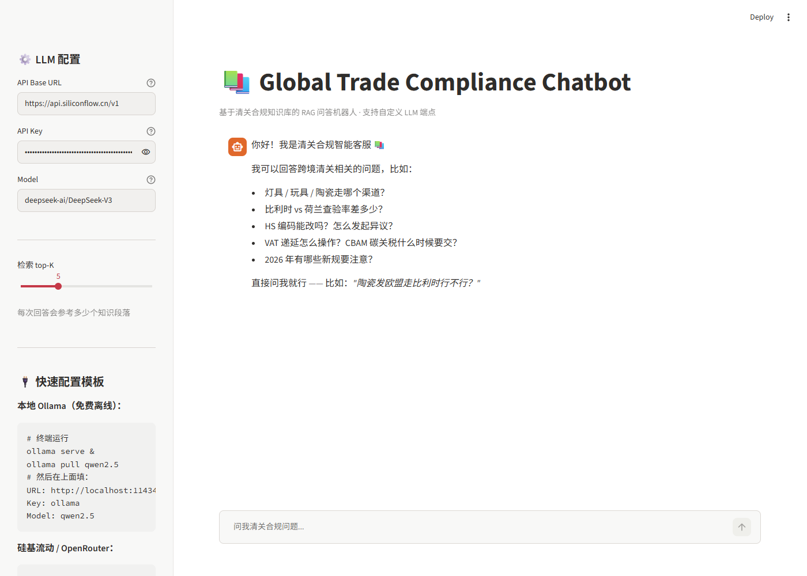
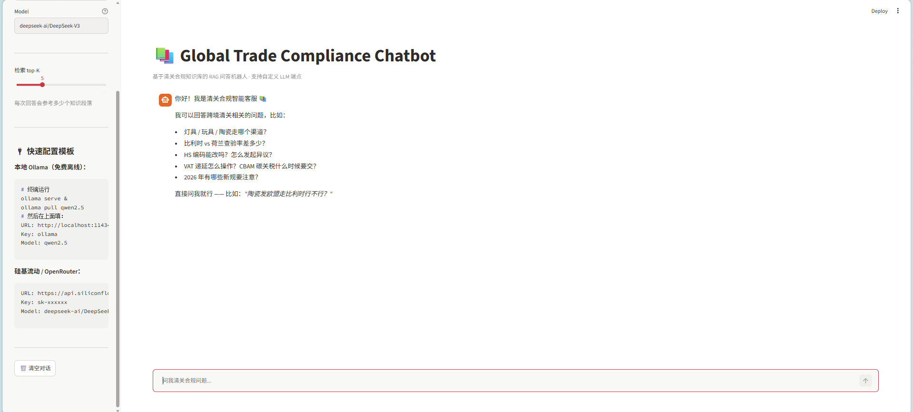

# 📚 Global Trade Compliance Playbook

> 跨境合规知识手册——给客服机器人当 RAG 语料，给跨境新人当 onboarding 教材

---

## 一句话：这是什么？

**不是代码工具，是一套结构化的跨境合规知识。**

做跨境电商的人都懂这个痛：清关行报过来的费用怎么算的？我的玩具走比利时还是荷兰？那个 EPR 注册到底需要花多少钱？海关查验率到底高不高？

大部分问题你问百度、问 Google，出来的都是零散的、过时的、互相矛盾的信息。这个 playbook 就是把跨境清关合规领域里**被清关行藏着、被老业务员垄断**的那些"暗知识"整理成一份**任何人都能按图索骥查到答案**的手册。

它原来就是喂给清关客服机器人做 RAG 检索的语料库——当有人问"灯具推荐哪个渠道"、"HS 编码选大类还是小类"、"CBAM 碳关税怎么算"的时候，机器人从这份知识里精准召回段落来回答。现在脱敏后开源，任何人都可以用。

---

## 核心内容（8 个知识模块）

| 文件 | 你能查到什么 |
|---|---|
| [01_overview.md](knowledge/01_overview.md) | 三种跨境物流形态区别、清关行四大评估维度、怎么分工 |
| [02_country_profiles.md](knowledge/02_country_profiles.md) | 7 个欧洲主要入境国/港口的政策风向（🟢🟡🔴 三色标注） |
| [03_channel_options.md](knowledge/03_channel_options.md) | 靠港清关 vs 监管仓、逆算申报 vs 固定申报、VAT 递延逻辑、四种主流渠道详解 |
| [04_product_matrix.md](knowledge/04_product_matrix.md) | 12 类品类 × 推荐渠道 × 禁止渠道 × 合规要点（一秒判断） |
| [05_risk_cases.md](knowledge/05_risk_cases.md) | 查验流程完整拆解、费用构成、隐藏成本、匿名化案例 |
| [06_review_checklist.md](knowledge/06_review_checklist.md) | 复核清关资料 7 项核对清单 + 异议发起模板 + 沟通正确姿势 |
| [07_fundamentals.md](knowledge/07_fundamentals.md) | 核心术语速查、海关四大风控红线（价格/归类/数据/描述）、EORI 信用体系 |
| [08_policy_updates.md](knowledge/08_policy_updates.md) | 2025-2028 年 4 大政策追踪（包装法、EUDR 零毁林、CBAM 碳关税、MRN 号新规） |

---

## 适用场景

### 🤖 场景 1：给智能客服当知识底座（原始用途）

把 `knowledge/*.md` 全部喂给 RAG 系统（LangChain、LlamaIndex、或任何支持 markdown 的检索框架），就能做一个清关合规问答机器人：

- 用户问："我有一批灯具要发到德国，走哪个渠道？" → 召回 04_product_matrix + 02_country_profiles 相关段落
- 用户问："为什么清关行把我的 HS 编码改了？我能反驳吗？" → 召回 06_review_checklist + 07_fundamentals
- 用户问："CBAM 碳关税怎么回事？" → 召回 08_policy_updates

### 📦 场景 2：跨境新人 onboarding（团队内部培训）

- 第一天：读 01_overview + 07_fundamentals，知道清关行怎么选、核心术语是什么
- 第二天：读 04_product_matrix，12 品类的渠道推荐直接记住
- 第三天：读 06_review_checklist，对着清单核对清关行发来的资料

**原来的客服新人入职要背厚厚一本手写笔记（全是老业务员口传的暗知识），现在直接给这个仓库。**

### 🛠️ 场景 3：你自己做跨境，遇到具体问题

比如你是做独立站的卖家，有一批陶瓷制品要发欧盟：
1. 先翻 [04_product_matrix.md](knowledge/04_product_matrix.md) — 陶瓷反倾销风险极高
2. 再翻 [02_country_profiles.md](knowledge/02_country_profiles.md) — 比利时严查，建议改其他入境点
3. 最后翻 [06_review_checklist.md](knowledge/06_review_checklist.md) — 拿到清关行资料时，对着 7 项清单核对

### 📋 场景 4：给清关行做评估

选清关行前，拿着 [01_overview.md](knowledge/01_overview.md) 里的四大评估维度去打分——操作配合度、时效与查验率、成本透明度、附加费说明。**不要只比报价低。**

### 🔍 场景 5：政策追踪与合规自查

2026 年有 4 项重大政策在影响跨境：包装法 8 月生效、EUDR 1 月强制、CBAM 首轮执行、法国 MRN 新规 9 月生效。[08_policy_updates.md](knowledge/08_policy_updates.md) 给了时间线和应对建议。

---

## 你在这份手册里能找到的数字（举几个例子）

这些都是原来从清关行通知、海关文件和实际运营经验里沉淀下来的：

| 数字 | 含义 | 来源 |
|---|---|---|
| **1200-1900 欧 / 次** | 海关查验的行业参考总成本（提柜 + 检测 + 卸柜 + 陪同 + 重柜 + 场地费） | 清关行费用清单汇总 |
| **5%-10%** | 比利时渠道申报件数的安全减幅（不能减太多，也不能加） | 海关实操经验 |
| **30%** | 固定申报的行业底线（可以高，不能低） | 清关行通知 |
| **20%-40%** | 逆算申报的合理比例区间 | 行业共识 |
| **1-3 天 vs 2 周-2 个月** | 荷兰 vs 比利时的典型放行/查验时效 | 实际运营数据 |
| **1-3% / 天** | 服装等季节性产品在查验期间的日均贬值率 | 供应商反馈 |
| **7 年** | 欧盟海关 HS 编码追溯期（别以为过去了就没事） | 欧盟海关法律 |

---

## 砍边角的功能（不做这些）

- ❌ **不提供 RAG 代码框架**——用 LangChain / LlamaIndex / Dify / FastGPT 都行，选你自己熟悉的
- ❌ **不维护实时政策数据库**——政策更新很快，清关行通知和海关官网是最权威的来源，这里只做结构化沉淀
- ❌ **不做实时检索 API**——这是知识本体，不是 SaaS
- ❌ **不覆盖所有品类和所有国家**——只覆盖有足够实践经验的部分，其他的欢迎社区贡献

---

## 文件结构

```
global-trade-compliance-playbook/
├── knowledge/                    ← 核心知识（8 个模块，全部可单独食用）
│   ├── 01_overview.md           ← 清关行评估 + 物流类型
│   ├── 02_country_profiles.md   ← 7 国/港口政策（🟢🟡🔴）
│   ├── 03_channel_options.md    ← 渠道详解（港清/监管仓、逆算/固定申报、VAT 递延）
│   ├── 04_product_matrix.md     ← 12 品类 × 渠道推荐矩阵
│   ├── 05_risk_cases.md         ← 查验流程 + 费用 + 隐藏成本 + 匿名化案例
│   ├── 06_review_checklist.md   ← 复核资料 7 项清单 + 异议模板
│   ├── 07_fundamentals.md       ← 术语速查 + 四大风控红线 + EORI 信用体系
│   └── 08_policy_updates.md     ← 2025-2028 政策追踪（4 大政策）
├── chatbot/                      ← 🤖 可直接运行的 RAG 智能客服
│   ├── app.py                  ← Streamlit 前端（聊天界面）
│   ├── rag.py                  ← RAG 管道（TF-IDF 检索 + LLM 流式生成）
│   ├── config.py               ← LLM / 检索参数配置（环境变量）
│   └── requirements.txt        ← 4 个轻依赖（streamlit / sklearn / requests / numpy）
├── examples/
│   └── sample_country.md        ← 示例：如何为一个新国家补充 profile
├── LICENSE                       ← MIT
└── README.md
```

---

## 🚀 5 分钟跑起智能客服

这是本项目最核心的交付物——**一个能直接运行的清关合规问答机器人**。零 LLM 模型下载（检索用 TF-IDF），只需配好 LLM API 端点就能跑。

### 第一步：安装依赖（4 个轻量包）

```bash
pip install -r chatbot/requirements.txt
```

### 第二步：配置 LLM（三选一）

#### 选项 A：本地 Ollama（完全免费、离线可用）

```bash
# 终端 1：启动 Ollama
ollama serve

# 终端 2：拉一个中文模型
ollama pull qwen2.5
```

然后设置环境变量（或在 Streamlit 侧边栏里填）：
```bash
export LLM_BASE_URL=http://localhost:11434/v1
export LLM_MODEL=qwen2.5
export LLM_API_KEY=ollama    # Ollama 不需要 key，填任意值即可
```

#### 选项 B：硅基流动 / OpenRouter（低成本、高质量）

```bash
export LLM_BASE_URL=https://api.siliconflow.cn/v1
export LLM_API_KEY=sk-xxxxxxxxxxxxxxxx
export LLM_MODEL=deepseek-ai/DeepSeek-V3
```

#### 选项 C：OpenAI / DeepSeek / 通义千问（任选 OpenAI-compatible 端点）

只要是符合 OpenAI `chat/completions` API 规范的端点都能用。

### 第三步：启动

```bash
streamlit run chatbot/app.py
```

浏览器自动打开 `http://localhost:8501`，就能聊了。

### 第四步：聊天

直接问问题，比如：
- "灯具推荐哪个渠道？比利时还是荷兰？"
- "HS 编码能改吗？怎么发起异议？"
- "查验费用一般多少钱？"
- "陶瓷发欧盟有什么风险？"
- "2026 年有哪些新规？"
- "CBAM 碳关税怎么算？"

**每个回答下面会显示 📚 参考来源**——告诉你答案来自哪个 knowledge 文件的哪个 section，方便你溯源验证。

### 可选：用环境变量一次性配置

不想每次在 Streamlit 侧边栏填？在 `.env` 或 shell 里设好就行：

```bash
export LLM_BASE_URL=http://localhost:11434/v1
export LLM_MODEL=qwen2.5
export LLM_API_KEY=ollama
export LLM_TOP_K=5
```

配置参数见 [chatbot/config.py](chatbot/config.py)。

### 运行界面长这样

| 首页 | 侧边栏展开 | 回答中（带参考来源） |
|---|---|---|
|  |  |  |

API Key 在侧边栏自动脱敏显示（星号），每个回答底部展示 📚 参考来源（具体到 knowledge/*.md 的哪个章节）。

---

## 培训文档

如果你是第一次接触 Streamlit / RAG，或者想把这套智能客服搭给自己的团队——**[智能客服操作手册](智能客服操作手册.docx)** 覆盖了从注册硅基流动 → 充值 → 启动 → 常见问题排查的完整流程，带真实截图。

---

## 其他使用方式

### 直接阅读（团队新人 onboarding）

直接打开 `knowledge/` 下的 .md 文件。如果是第一次接触跨境清关，建议按文件编号顺序读：第一天 overview + fundamentals，第二天 product matrix，第三天 review checklist。

### 把知识喂给你自己的 RAG 系统

本项目的 chatbot 是**轻量零下载方案**。如果你想用 LangChain / LlamaIndex / Dify / FastGPT 等完整框架，直接把 `knowledge/*.md` 全部加载进去就行：

```python
# LangChain 示例
from langchain.text_splitter import RecursiveCharacterTextSplitter
from langchain_community.document_loaders import DirectoryLoader

loader = DirectoryLoader("global-trade-compliance-playbook/knowledge/", glob="*.md")
docs = loader.load()
splitter = RecursiveCharacterTextSplitter(chunk_size=500, chunk_overlap=50)
splits = splitter.split_documents(docs)

# 存入你的向量库即可
```

### 命令行测试 RAG 检索质量

不调 LLM，只看检索对不对（调试/选 chunk size 时用）：

```bash
python chatbot/rag.py   # 进入交互模式，输入问题只检索不生成
# 或
python _test_rag.py     # 预设 6 个测试 query 看检索命中
```

### 补充新知识

参考 [examples/sample_country.md](examples/sample_country.md) 的格式，为新的国家/品类添加 profile。提交 PR 欢迎。

---

## 贡献

如果你的清关行有新的渠道选项、你验证了新的申报比例、或者你发现某个国家的政策已经变化了——欢迎提交 PR 或 Issue。

特别欢迎：
- 非欧洲地区的清关政策补充
- 新兴品类（如储能产品、光伏设备）的合规要点
- 你所在清关行的实际费率参考（匿名化处理即可）

---

## License

MIT © ivy92888-glitch

---

## English Summary

> This playbook was originally an internal RAG knowledge base for a customs compliance chatbot. Now open-sourced and sanitized.

**What it is:** A structured, open-source knowledge base for cross-border customs compliance — not code, but *structured knowledge* that any RAG system can ingest and that any team member can read.

**What's in it:** 8 knowledge modules covering customs broker evaluation, country-by-country port policies, channel selection (port clearance vs bonded warehouse, fixed vs reverse-calculated declaration, VAT deferral), a product-to-channel recommendation matrix for 12 categories, customs inspection breakdowns, a 7-item document review checklist with template, 20+ terminology quick-reference, 4 customs risk-control red lines, and a 2025-2028 major policy tracker (EU Packaging Regulation, EUDR Deforestation, CBAM Carbon Border Tax, French MRN requirement).

**What it's good for:**
- 🤖 Feeding into a RAG system (LangChain / LlamaIndex / Dify) to build a customs compliance chatbot
- 📦 Onboarding new team members in cross-border logistics — replaces hand-written secret internal notes
- 🛠️ Self-use: look up "which channel for ceramic tiles" → check the product matrix → check country profile → review with the checklist
- 📋 Evaluating and selecting customs brokers with the 4-dimension rubric
- 🔍 Policy tracking and compliance self-check for 2026-2028

**What we deliberately don't do:** No RAG framework code, no real-time policy database, no API service, and we don't claim to cover every product category or every country. Community contributions welcome.

**License:** MIT
